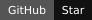
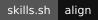

<p align="center">
  
</p>

<h1 align="center">ALIGNS.md</h1>

<p align="center">
  <a href="../../README.md" lang="en">English</a> · <a href="ko.md" lang="ko">한국어</a> · <strong lang="ja">日本語</strong>
</p>

<p align="center">
  <a href="../../LICENSE"></a>
  <a href="https://github.com/hmmhmmhm/aligns.md/stargazers"></a>
  <a href="#install-align"></a>
  <a href="https://skills.sh/hmmhmmhm/aligns.md/align"></a>
</p>

## よい結果の基準を決める

ALIGNS.mdには、エージェントに目指してほしい目標と、何かを選ぶときに優先したいことを記録します。**align** スキルを使ってその基準をすり合わせ、作業の変化に応じて見直せます。

<p align="center">
  
</p>

## 期待することを分けて管理する

個人の判断基準はALIGNS.mdに、繰り返し使えるすり合わせの手順はスキルに置きます。AGENTS.mdやCLAUDE.mdなど、主に使うエージェントの指示ファイルからALIGNS.mdを参照するようにしてください。Gitを使っている場合は、その履歴で変更を追います。スキルを更新しても、合意した基準は書き換わりません。

専門スキルも、この基準に沿って使います。スキルの標準スタイルが自分の好みとして保存されることはなく、ALIGNS.mdですでに決めたことを聞き直されることもありません。 開発・デザイン・レビュー・文章の編集に併用できるスキルは、[おすすめスキル](../recommended-skills.md)（英語）にまとめています。

<p align="center">
  
</p>

## 自分の好みを伝える手間が減ります

一度すり合わせた基準は、次の作業にも引き継がれます。エージェントが把握した好みをもとに判断するので、毎回やり方を説明したり、一つひとつ選んだりする手間が減ります。

思っていた結果と違ったら、一緒に基準を見直して、次の作業に反映します。

[実験結果と方法](../../RETENTION_BENCHMARK.md)

<p align="center">
  <a href="../../RETENTION_BENCHMARK.md"></a>
</p>

## 必要なときに、またすり合わせる

大事な判断が意図とずれたとき、同じ修正を繰り返して足りない基準に気づいたとき、次に何をすればよいか迷ったときに、すり合わせを見直します。選んだPRのフィードバックや、参照できるプロジェクトの会話を振り返ることもできます。繰り返し現れる判断基準を「好みの不変性（taste invariants）」として捉え、適用範囲や例外とともに確認します。所要時間の目安を見てから、最近の履歴だけを見るか、全体を見るかを選んでください。長い自律作業を任せる前には、いくつかの仮の場面で判断を試します。明らかな誤りはその場で直し、すでに答えた質問は繰り返しません。

依頼は短くても構いません。エージェントは既存の文脈を確認し、結果を大きく左右する情報が足りないときにだけ質問します。いつ質問し、いつ自分で判断して進めるかも相談できます。ALIGNS.mdに残すのは、今後も適用すると確認した方針だけです。

<p align="center">
  
</p>

<a id="install-align"></a>

## alignをインストールする

次の依頼文をエージェントに貼り付けてください。継続的にメンテナンスされるスキルをインストールし、更新方法を決めて、プロジェクトにつなぎます。

```text
このプロジェクトに、https://github.com/hmmhmmhm/aligns.md のalignスキルをセットアップしてください。最新のインストールガイドを読み、既存のインストール状況とエージェントの指示を確認したうえで、私が主に使うCLIでサポートされている方法を選んでください。主に使うCLIが何か、今使っているCLIと同じかは、不明な場合だけ確認してください。

サポートされている方法で、すり合わせの手順を自動更新するようにしてください。クライアントに自動更新機能がなければ、すり合わせのセッション開始時に、既存のインストール範囲を保ったまま、このスキルだけを更新してください。オフラインでは、動作するインストール済みバージョンを維持してください。どの更新方法が有効になっているかを説明し、スケジューラーの追加や無関係なパッケージの更新はしないでください。

スキルを使ってALIGNS.mdを作成または見直し、主に使う指示ファイルから参照するようにしてください。既存のルールや個別に管理されているファイルを保ち、ほかに使っているクライアントには安全なリンク方法を提案してください。スキルの呼び出し方と更新方針をALIGNS.mdに記録してください。すでに明確に答えた内容は聞き直さないでください。大事な判断が意図とずれたとき、判断基準をまだ確かめていない長い自律作業の前、次の方向を決められないときには、必要な点に絞ったすり合わせを提案してください。手順を更新しただけで、私の判断基準を書き換えたり、私が合意したとみなしたりしてはいけません。
```

複数のツールで使えるスキルを直接インストールすることもできます。

```sh
npx skills add hmmhmmhm/aligns.md --skill align
```

インストール後に、こう依頼してください。**alignスキルを使って、このプロジェクトで継続的にすり合わせができるように設定してください。**

スキルが使える環境なら、いつでも「このプロジェクトの判断基準をすり合わせたい」と話しかけてください。コマンドや決まった言い方は必要ありません。何から始めるか迷ったら、番号で選べます。プロジェクトの基準づくり、期待とずれた判断の見直し、履歴の確認、長い自律作業の前の判断練習、始め方の提案、複数のプロジェクトで使う個人の共通基準の設定から選んでください。エージェントが手順を短く説明し、一緒に進めます。やりたいことをすでに伝えていれば、メニューは省略します。必要に応じて保存を確認し、一つ終わったら、完了済みの項目や断った項目を除いて次の候補と終了の選択肢を示します。残った項目から次に取り組むものを勧めます。クライアントが対応していれば選択式の質問画面を使い、そうでなければ番号付きの一覧を表示します。

「複数のプロジェクトで使う自分の好みを整理したい」と頼むと、個人用のALIGNS.mdを設定できます。手元の個人用ドキュメントやメモを参考に、共通の基準を整理できます。決まったファイル名や形式はありません。共通の好みと職場のルールは分けて扱います。ローカルファイルで管理でき、希望する場合だけ個人用の別リポジトリにも接続できます。[個人の基準の設定と保存先](../usage.md#personal-defaults-across-projects)（英語）。

CodexとClaude Codeでは、各クライアントのプラグインとしてインストールできます。Claude Codeでは、このマーケットプレイスの自動更新を有効にすると、更新を受け取れます。ほかのインストール方法では、ユーザーの許可を得たうえで、すり合わせのセッション開始時に更新できます。バックグラウンド更新や、あらゆる環境での自動起動を前提にはしていません。

[インストールと更新](../usage.md) · [動作ベンチマーク](../../BENCHMARK.md) · [ユーザー介入の予備実験](../../EFFORT_BENCHMARK.md) · [好みの引き継ぎ](../../DISCOVERY_BENCHMARK.md) · [好みの保持](../../RETENTION_BENCHMARK.md) · [検証](../validation.md) · [配布](../distribution.md)

## プロジェクトにバッジを付ける

ALIGNS.mdを使っているプロジェクトのREADMEに、このバッジを付けられます。下のMarkdownをコピーしてください。

[](https://github.com/hmmhmmhm/aligns.md)

```markdown
[](https://github.com/hmmhmmhm/aligns.md)
```

## ライセンス

[MIT](../../LICENSE). Copyright (c) 2026 hmmhmmhm.

<p align="center">
  
</p>
