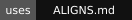

<p align="center">
  
</p>

<h1 align="center">ALIGNS.md</h1>

<p align="center">
  <a href="../../README.md" lang="en">English</a> · <strong lang="ko">한국어</strong> · <a href="ja.md" lang="ja">日本語</a>
</p>

<p align="center">
  <a href="../../LICENSE"></a>
  <a href="https://github.com/hmmhmmhm/aligns.md/stargazers"></a>
  <a href="#install-align"></a>
  <a href="https://skills.sh/hmmhmmhm/aligns.md/align"></a>
</p>

## 좋은 결과의 기준을 정하세요

ALIGNS.md에는 에이전트가 따라야 할 목표와, 선택이 필요할 때 무엇을 우선할지 적습니다. **align** 스킬로 이 기준을 함께 정하고, 작업이 달라지면 다시 살펴볼 수 있습니다.

<p align="center">
  
</p>

## 기대하는 바를 따로 관리하세요

개인의 판단 기준은 ALIGNS.md에, 여러 프로젝트에서 쓸 정렬 방법은 스킬에 둡니다. AGENTS.md나 CLAUDE.md처럼 주로 쓰는 에이전트 지시 파일에서 ALIGNS.md를 참조하게 하세요. Git을 쓰는 프로젝트라면 변경 사항은 Git 이력으로 추적합니다. 스킬을 업데이트해도 합의한 기준은 바뀌지 않습니다.

전문 스킬도 이 기준에 맞춰 사용합니다. 스킬의 기본 스타일을 내 취향으로 저장하지 않으며, ALIGNS.md에서 이미 정한 사항은 다시 묻지 않습니다. 개발·디자인·검토·글쓰기에 함께 쓸 스킬은 [추천 스킬 문서](../recommended-skills.md)(영어)에 정리했습니다.

<p align="center">
  
</p>

## 내 취향을 설명하는 수고가 줄어듭니다

한 번 맞춰둔 기준은 다음 작업에도 이어집니다. 에이전트가 이미 아는 취향을 바탕으로 판단하니, 매번 원하는 방식을 설명하거나 선택해줄 일이 줄어듭니다.

생각과 다른 결과가 나오면 기준을 함께 고쳐, 다음 작업에 반영합니다.

[실험 결과와 방법](../../RETENTION_BENCHMARK.md)

<p align="center">
  <a href="../../RETENTION_BENCHMARK.md"></a>
</p>

## 필요할 때 다시 정렬하세요

중요한 판단이 의도와 어긋났거나, 같은 수정을 반복하며 빠진 기준을 발견했거나, 다음에 무엇을 해야 할지 막막할 때 정렬을 다시 진행하세요. 선택한 PR 피드백과 접근 가능한 프로젝트 대화에서 반복해서 드러나는 판단 기준, 즉 취향 불변성을 찾아 적용 범위와 예외도 살펴볼 수 있습니다. 예상 시간을 확인한 뒤 최근 이력부터 볼지, 전체를 볼지 고르세요. 에이전트에게 긴 작업을 맡기기 전에는 가상의 선택 상황 몇 가지로 판단을 맞춰 봅니다. 명백한 오류는 바로 고치고, 이미 답한 질문은 되풀이하지 않습니다.

짧게 요청해도 됩니다. 에이전트는 기존 맥락을 먼저 확인하고, 결과를 크게 바꿀 정보가 빠졌을 때만 질문합니다. 언제 묻고 언제 판단해서 진행할지도 함께 정할 수 있습니다. ALIGNS.md에는 앞으로도 적용하기로 확인한 선호만 남깁니다.

<p align="center">
  
</p>

<a id="install-align"></a>

## align 설치하기

아래 요청문을 에이전트에 붙여 넣으세요. 지속적으로 관리되는 스킬을 설치하고 업데이트 방식을 정한 뒤, 프로젝트에 연결합니다.

```text
이 프로젝트에 https://github.com/hmmhmmhm/aligns.md 의 align 스킬을 설치해 주세요. 최신 설치 가이드를 읽고, 기존 설치 상태와 에이전트 지시 파일을 확인한 뒤, 제가 주로 쓰는 CLI에서 지원하는 방법으로 설치해 주세요. 주로 쓰는 CLI가 무엇인지, 지금 쓰는 CLI와 같은지는 불분명할 때만 물어봐 주세요.

지원되는 방식으로 정렬 방법의 자동 업데이트를 활성화해 주세요. 클라이언트에 자체 자동 업데이트 기능이 없다면, 정렬 세션을 시작할 때마다 기존 설치 범위를 유지하면서 이 스킬만 업데이트해 주세요. 오프라인에서는 정상 작동하는 설치 버전을 유지해 주세요. 어떤 업데이트 방식이 적용됐는지 알려주고, 스케줄러를 추가하거나 관련 없는 패키지를 업데이트하지 마세요.

스킬로 ALIGNS.md를 작성하거나 검토하고, 주 지시 파일에서 이를 참조하게 해 주세요. 기존 규칙과 별도로 관리되는 파일은 보존하고, 제가 쓰는 다른 클라이언트에는 안전한 링크 방식을 제안해 주세요. ALIGNS.md에 스킬 호출법과 업데이트 방식을 기록해 주세요. 명확히 답한 내용은 다시 묻지 말고, 중요한 판단이 어긋났을 때, 아직 기준을 점검하지 않은 긴 자율 작업을 시작하기 전, 또는 제가 다음 방향을 정하지 못할 때 필요한 부분만 정렬하도록 제안해 주세요. 정렬 방법을 업데이트했다고 제 판단 기준을 바꾸거나 제가 동의한 것으로 간주해서는 안 됩니다.
```

여러 도구에서 사용할 수 있는 스킬을 직접 설치해도 됩니다.

```sh
npx skills add hmmhmmhm/aligns.md --skill align
```

설치한 뒤 이렇게 요청하세요. **align 스킬로 이 프로젝트에서 지속적으로 정렬할 수 있도록 설정해 주세요.**

무엇부터 할지 모르겠다면 `$align`을 호출하고 번호로 고르세요. 프로젝트 기준 정리, 기대와 달랐던 판단 점검, 기록 검토, 긴 작업 전 판단 연습, 시작점 추천 중에서 선택할 수 있습니다. 에이전트가 진행 순서를 짧게 안내하고 함께 진행합니다. 원하는 작업을 이미 말했다면 메뉴는 건너뜁니다.

Codex와 Claude Code에서는 자체 플러그인 방식으로 설치할 수 있습니다. Claude Code는 해당 마켓플레이스의 자동 업데이트를 켜면 업데이트를 받을 수 있습니다. 다른 설치 경로에서는 사용자가 허용한 경우 정렬 세션을 시작할 때 업데이트할 수 있습니다. 백그라운드 업데이트나 모든 환경에서의 자동 실행을 전제로 하지는 않습니다.

[설치 및 업데이트](../usage.md) · [동작 벤치마크](../../BENCHMARK.md) · [사용자 개입 예비 실험](../../EFFORT_BENCHMARK.md) · [선호 전이](../../DISCOVERY_BENCHMARK.md) · [선호 유지](../../RETENTION_BENCHMARK.md) · [검증](../validation.md) · [배포](../distribution.md)

## 프로젝트에 배지 붙이기

ALIGNS.md를 쓰는 프로젝트라면 README에 이 배지를 붙일 수 있습니다. 아래 Markdown을 복사하세요.

[](https://github.com/hmmhmmhm/aligns.md)

```markdown
[](https://github.com/hmmhmmhm/aligns.md)
```

## 라이선스

[MIT](../../LICENSE). Copyright (c) 2026 hmmhmmhm.

<p align="center">
  
</p>
